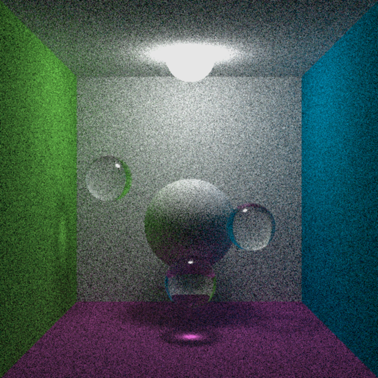
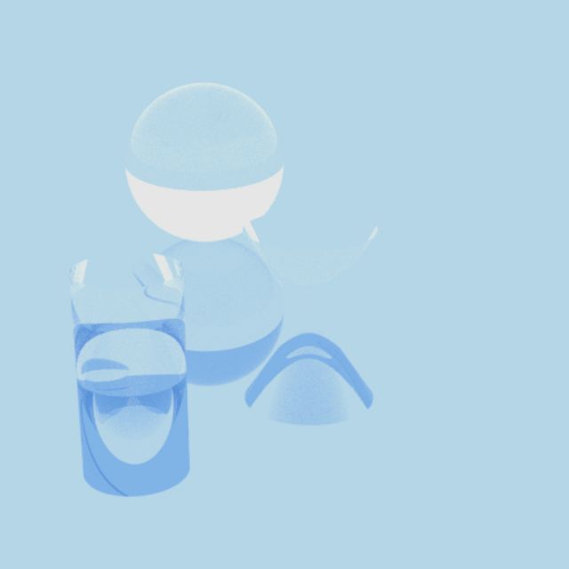

<div align="center">

# Raytracer

**A path tracer in C++20: describe a scene in a text file and get a rendered image.**

  

<sub>Team of 4 · May 2024</sub>

</div>

<p align="center"> </p>
<p align="center"><sub>Left: a Cornell box with a ceiling light and glass spheres. Right: cylinder, cone and spheres.</sub></p>


## About the project

The raytracer reads a scene description (camera, lights, shapes, materials), shoots rays through every pixel, and writes a PPM image. Rendering is spread over several **processes** to use every core, and a bounding-volume hierarchy keeps complex scenes fast.

- **Shapes**: plane, sphere, cylinder, cone, box, triangle, and meshes from OBJ files
- **Materials**: matte, metal and dielectric (glass)
- **Textures**: solid colors and checkerboards
- **Lights and transforms**: point and directional lights, rotation and translation
- **Camera**: field of view, depth of field, and a live preview mode with `-g`

## Build and run

```bash
make
./raytracer scenes/reflected_shapes.cfg      # writes scenes/reflected_shapes.ppm
./raytracer -g                               # see the pixels appear in real time
```

Needs `libconfig++` and SFML. Scenes live in [`scenes/`](scenes). The sample scenes are heavy, so lower `sample` and `ratio` in the file for a quick preview. Some sample scenes end lists with a trailing comma, which older libconfig versions reject: remove it if you get a parse error.

## My contribution

10 of the project's 56 commits, in the first week of the project.

- **Scene parsing**: the parser that turns a `libconfig` file into the camera, lights and primitives, including transformations
- **Factory**: the builder classes that create each shape from its configuration
- **Shapes and lights**: the cone shape, and work on lights and materials
- **Camera**: adjustments to the camera class

## Team

Alexandre Vigoureux, Yanis Harkouk, Eva Legrand, Mathis Brehm.
